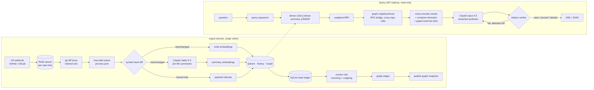

# code-rag — Cross-Repo Semantic Code Search & Citation-Enforced RAG

Ask questions across many repositories ("how does checkout charge the customer through billing?")
and get answers where **every factual sentence carries a `(org/repo/path:start-end)` citation that
is machine-verified** against the index. Built for multi-repo, multi-language codebases
(Python, TypeScript, Go, Rust, Protobuf) with **symbol-level incremental re-indexing** driven by git
webhooks.

```
$ code-rag ask "How is money converted to minor units before calling billing?"
· expand_query · retrieve_hybrid · fuse_rrf · expand_graph · rerank · synthesize · verify
...
- `acme_common.money.Money.to_minor_units` converts to integer minor units using banker's
  rounding (acme/shared-py/acme_common/money.py:16-20).
citations passed  faithfulness=1.00  attempts=1  total=66ms
```

## What makes it different

| Problem | Approach |
|---|---|
| Fixed-size chunks split functions and lose structure | **AST chunking** with tree-sitter: one chunk per function/method/class/struct/trait/impl/interface; large containers become *skeletons* (member bodies collapsed) so a class chunk does not duplicate its methods |
| Re-embedding whole files on every commit | **Two hashes per symbol**: `content_hash` (AST tokens, comment/whitespace-insensitive) decides re-embedding; line moves only update payload. A 50-file commit re-embeds only the symbols whose logic changed |
| Cross-repo relationships are invisible to vector search | **Symbol graph** (embedded Cypher DB): `CALLS / INHERITS / IMPLEMENTS` resolved across repos by late binding, plus a **gRPC bridge** `client -CALLS_RPC-> RpcEndpoint <-SERVES_RPC- server` that links Python/TS clients to Go servers and `.proto` declarations |
| Hallucinated citations | **Citation verifier**: each sentence must cite an indexed file, within its line count, overlapping a chunk that was *actually shown to the model*; code snippets must appear verbatim. Failures produce targeted feedback and an automatic re-ask; still-unverifiable claims are pruned or the system abstains |
| Stale indexes | Git webhooks → queue → single-writer worker; diffs from the ledger's indexed sha, so redelivered / out-of-order / force-pushed events are safe |

## Architecture



Clean/hexagonal layout — the domain has no framework imports; every external system is an adapter
behind a port:

```
src/code_rag/
├── domain/          entities, value objects, errors, ports (Protocols)
├── application/     ingest workflow, symbol differ/resolver, LangGraph agent, citation verifier, evaluation
├── infrastructure/  tree-sitter extractors, Qdrant/Tantivy/graph/SQLite adapters, Voyage/Claude/TEI/vLLM
│                    adapters, git + webhooks, tracing, settings, composition root
└── interfaces/      FastAPI (REST + SSE + webhooks), arq worker, Typer CLI
```

### Storage schemas

| Store | Role | Key design |
|---|---|---|
| **Qdrant** | dense retrieval | collection `chunks__{model}__{dim}` (one per embedding model) + alias `chunks_active`; named vectors `code` and `summary`; point id = `uuid5(symbol_id)` (idempotent); payload carries location, source, summary, `is_generated`, `is_test`; generated code is **down-weighted** server-side with a score-boosting formula, not filtered |
| **Tantivy** | BM25F | fields `symbol_name` (×4), `summary` (×2), `body` (×1); identifiers expanded (`getUserById` → `getuserbyid get user by id`); upsert = delete-by-term + add |
| **Graph** (LadybugDB) | cross-repo context | `Repo, File, Symbol, RpcEndpoint`; `DEFINES, MEMBER_OF, CALLS, INHERITS, IMPLEMENTS, CALLS_RPC, SERVES_RPC, DECLARES_RPC` with `cross_repo` / `confidence` |
| **SQLite ledger** | source of truth | per-symbol `content_hash` + lines, file records (imports, line counts), unresolved refs (indexed by target name), ingest runs, pending summary batches |

> **Kùzu note.** The RFC specified Kùzu. Upstream `kuzudb/kuzu` was archived on 2025‑10‑10, so the
> adapter targets **LadybugDB** (`ladybug`, its maintained fork, same Cypher + Python API) and falls
> back to `kuzu` if that is what is installed.

## Quickstart (offline, no API keys)

Requires Python 3.12+, [uv](https://docs.astral.sh/uv/) and git.

```bash
uv sync
make demo                  # index → graph → ask (JSON + SSE) → signed webhook re-index → guardrail
make eval-fixture          # indexes the 6-repo fixture corpus and runs the 25-question benchmark
make check                 # ruff + mypy --strict + 57 tests
```

The `offline` profile swaps models for deterministic adapters (feature-hashed embeddings, docstring
summaries, BM25 reranker, extractive synthesizer) so the **entire pipeline** — parsing, graph, hybrid
retrieval, verification, SSE, webhooks — runs in CI with no network.

## Cloud profile (Voyage + Claude)

```bash
cp .env.example .env                   # ANTHROPIC_API_KEY, VOYAGE_API_KEY, webhook secrets
cp config/repos.example.yaml config/repos.yaml   # list your repositories (remote or local path)
export CODE_RAG_CONFIG=config/settings.cloud.toml

uv run code-rag index                  # first run: full index; later runs: incremental
uv run code-rag ask "Where do we retry failed payment captures?"
uv run code-rag search "idempotency key" --repo acme/billing-go
uv run code-rag serve                  # http://localhost:8080 (single-process mode)
```

| Component | Default | Why |
|---|---|---|
| Code embeddings | `voyage-code-3` (1024d) | code-specialised retrieval |
| Summary embeddings | `voyage-3.5` | natural-language side of the dual representation |
| Summaries | `claude-haiku-5-5`, effort `low`, structured JSON, cached system prompt | one request per **file** (not per symbol); bulk indexing goes through the **Message Batches API** (50% cheaper) and is applied asynchronously (`code-rag summaries sync`, also a worker cron) |
| Reranker | Voyage `rerank-2.5` | cross-encoder top-50 → top-10 |
| Synthesis | `claude-opus-5-5`, effort `medium`, streaming | server-side refusal **fallbacks** enabled (`server-side-fallback-2026-07-01`, `fallbacks: "default"`); a final refusal becomes an explicit abstention |

Summaries are optional: if the summarizer fails or declines, the symbol is still indexed by code
vector + BM25 (degraded, never blocking).

### Local / self-hosted profile

`config/settings.local.toml` points at HuggingFace **TEI** servers (`nomic-embed-code`,
`nomic-embed-text`, `bge-reranker-v2-m3`) and **vLLM** (Qwen2.5-Coder) — no data leaves your network.
`nomic-embed-code` is a 7B model: plan for a ~24 GB GPU.

## Production deployment

```bash
docker compose up -d --build     # api (read-only, 2 workers) + worker (single writer) + qdrant + redis
```

* **Roles.** `CODE_RAG_ROLE=api` opens Tantivy and the graph **read-only** and enqueues webhook jobs;
  `CODE_RAG_ROLE=worker` is the only writer. `CODE_RAG_ROLE=all` runs everything in one process
  (dev / small installs).
* **Graph snapshots.** Embedded graph DBs allow one writer process. After every ingest the worker
  `CHECKPOINT`s and atomically swaps `graph/current -> snapshots/<ts>`; API processes reopen the new
  snapshot transparently. Old snapshots are pruned (keeps 3).
* **Qdrant** must be a server in multi-process deployments (embedded mode is single-process and slow).

### Webhooks

Point a GitHub webhook (content type `application/json`, push events, secret =
`CODE_RAG_WEBHOOKS__GITHUB_SECRET`) or a GitLab push hook (secret token =
`CODE_RAG_WEBHOOKS__GITLAB_SECRET`) at `POST /webhooks/git`.

* HMAC-SHA256 (GitHub) / constant-time token (GitLab) verification → 401 on mismatch.
* Only the configured branch (default `main`, override per repo) is indexed.
* Job id `ingest:<repo>:<sha>` dedupes redeliveries; a per-repo Redis lock serializes runs.
* The worker diffs from the **ledger's indexed sha**, not the payload's `before`: coalesced pushes are
  handled in one run, stale events (older than the indexed sha) are skipped, and rewritten history
  (force-push) triggers a full reconcile.

### API

| Method | Path | Notes |
|---|---|---|
| `POST` | `/api/v1/ask` | JSON `CitedAnswer`; with `"stream": true` or `Accept: text/event-stream` → SSE events `stage`, `token`, `retry`, `final` |
| `POST` | `/api/v1/search` | retrieval only, ranked contexts with anchors |
| `POST` | `/webhooks/git` | GitHub / GitLab push |
| `GET` | `/api/v1/repos`, `/api/v1/runs` | indexed shas, ingest run history with stage timings |
| `GET` | `/healthz`, `/readyz` | liveness / readiness (vector store reachable) |

## Operations runbook

| Situation | Action |
|---|---|
| Ingest crashed mid-run | Nothing to do: re-run (or let the job retry). Stores are written before the ledger, all upserts are keyed by deterministic ids, and `indexed_sha` only advances at the end |
| Suspected drift between stores | `code-rag index <repo> --full` reconciles every file and deletes symbols of vanished files |
| Switch embedding model (A/B) | set the new model, `code-rag index --full` (writes a *new* collection), compare with `code-rag eval run`, then `code-rag activate-collection` to move the `chunks_active` alias |
| Bulk summaries pending | `code-rag summaries sync` (worker cron runs it every 5 min) |
| Index status | `code-rag stats`, `GET /api/v1/runs` (per-stage timings of every run) |
| Tracing | `CODE_RAG_TRACING__BACKEND=langfuse` (Langfuse SDK, OTel-based) or `otel` (any OTLP backend); every stage is a span (`expand_query`, `retrieve_hybrid`, `expand_graph`, `rerank`, `synthesize` as a generation, `verify_citations`; ingest: `parse`, `summarize`, `embed`, `write_stores`, …). Per-stage latency is also returned in every answer (`timings_ms`) |

## Evaluation

```bash
code-rag eval run --questions eval/questions.jsonl [--judge] [--retrieval-only] [--min-mrr 0.6]
code-rag eval generate --n 100 --out eval/questions.generated.jsonl   # from cross-repo graph edges
code-rag eval ingest-bench acme/billing-go --commits 20               # replays real commits, checks SLO
uv run python scripts/scale_bench.py --files 2000 --changed 50 --qdrant-url http://localhost:6333
```

Metrics: **MRR@10**, graded **nDCG@10**, **Recall@10** against gold symbols (by repo + qualified
name or file/line range); **citation faithfulness** = verified claims / all claims (structural), plus
optional **judge faithfulness** (LLM entailment of each claim against the exact cited lines);
verification pass rate, abstain rate; **p50/p95/p99** end-to-end and per-stage latency.

**Building the 100-question cross-repo set for your repos:** `eval generate` samples symbol pairs
connected *across repositories* (resolved calls, inheritance, gRPC client↔server) and asks Claude to
write a question that needs both; both symbols become gold. Review/edit the output (it is a draft),
add hand-written questions for flows the graph cannot see (HTTP between services, queues), and save
as `eval/questions.jsonl`.

### Results so far (offline profile — a pipeline baseline, not model quality)

Fixture corpus: 6 repos, 5 languages, 69 symbols; 25 curated questions (`eval/questions.fixture.jsonl`).

| Metric | Value |
|---|---|
| MRR@10 / nDCG@10 / Recall@10 | 0.685 / 0.686 / 0.877 |
| cross-repo RPC questions MRR@10 | 0.575 |
| Citation faithfulness / verification pass rate | 1.00 / 1.00 |
| Latency p50 / p95 / p99 | 126 / 185 / 200 ms |

Freshness SLO, synthetic monorepo (2,000 files, **216k LOC**, 28k symbols), commits touching 50 files
(100 symbols re-embedded + 650 relocated per commit), offline models, **embedded** Qdrant:
worst incremental re-index **16.7 s** (< 60 s SLO). ~85% of that time is embedded-Qdrant payload
writes; rerun with `--qdrant-url` against a Qdrant server for production numbers, and with
`--profile cloud` to include summarization/embedding latency (budget: ~6–12 s for 50 parallel
per-file summary requests + 2–4 s embeddings).

Cloud-profile numbers (MRR with `voyage-code-3` + `rerank-2.5`, judge faithfulness) require API keys:
`uv run python scripts/fixture_eval.py --profile cloud --judge`.

## Extension exercises (ports already in place)

* **A/B embedding models** — `voyage-code-3` vs `nomic-embed-code`: separate collections per model,
  same evaluator, alias cut-over.
* **Generated-code poisoning** — `is_generated` from path globs + "Code generated … DO NOT EDIT"
  headers; down-weighted in Qdrant (score formula), Tantivy and the reranker (`generated_penalty`),
  still retrievable with `include_generated=true`.
* **Cross-language resolution** — Python/TS gRPC stubs → `CALLS_RPC` → `RpcEndpoint` ←
  `SERVES_RPC` Go servers ← `DECLARES_RPC` `.proto` rpc symbols.

## Known limitations

* Name-based resolution without type inference: `x.charge()` links only when the receiver name
  matches the owner type, the import is explicit, or the method name is globally unique (low
  confidence, below the default 0.5 expansion threshold). A language-server (SCIP/LSIF) importer is
  the natural next adapter.
* HTTP/queue links between services are not modelled as graph edges (gRPC is).
* Batch summaries are matched by symbol id; a symbol changed again before its batch finishes gets the
  older summary until its next change.
* The fixture benchmark is small; trust numbers only from a reviewed question set over your own repos.
